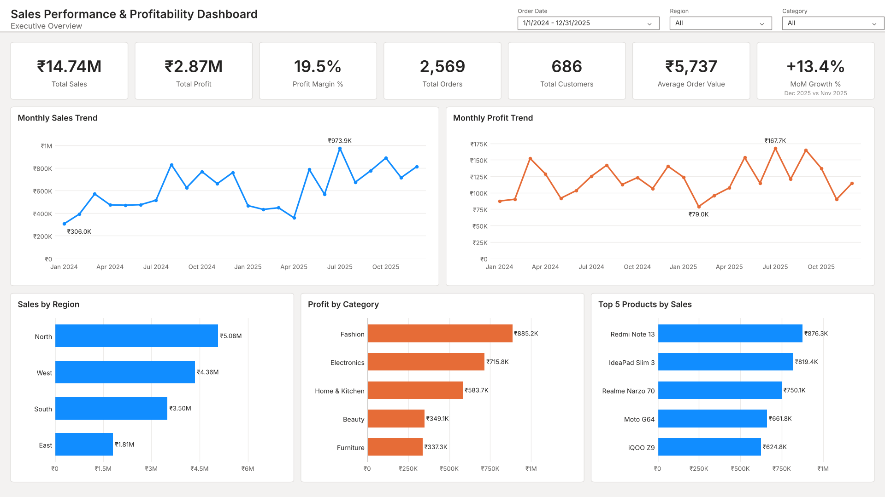
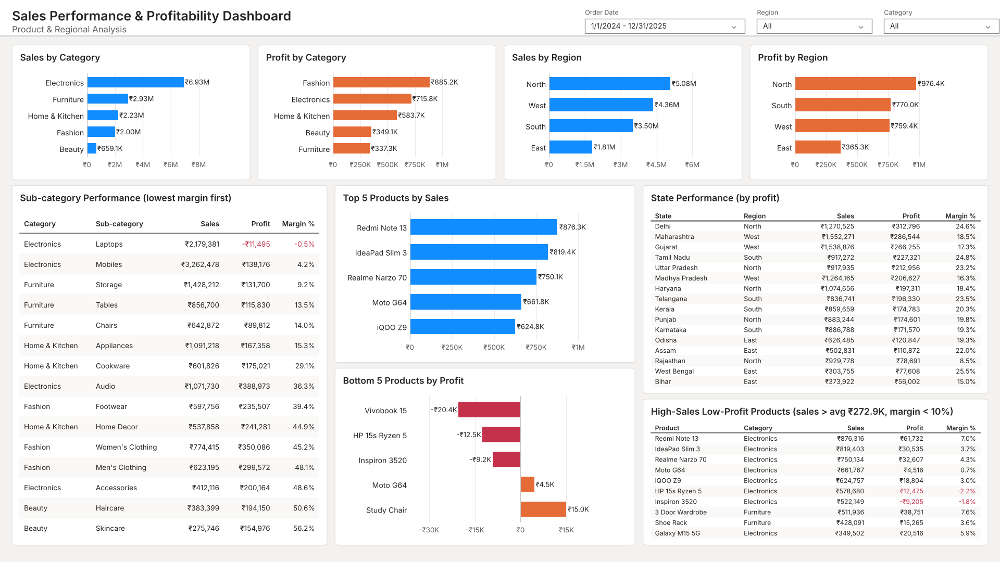
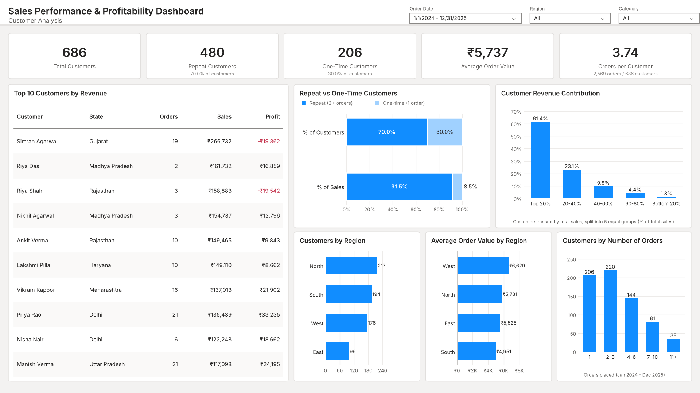

# Sales Performance & Profitability Dashboard

## Objective

This project analyzes retail sales data to understand sales trends, profitability, product performance, regional performance and customer behavior. I cleaned and analyzed the data in PostgreSQL, then designed a 3-page Power BI report and created DAX measures for the main KPIs.

## Tools

PostgreSQL, Power BI (DAX, Power Query), Python (pandas, for generating and validating the data)

## KPIs

Two years of data (Jan 2024 to Dec 2025): 3,787 raw rows, 3,739 cleaned and validated rows used for the analysis.

| KPI | Value |
|---|---|
| Total Sales | ₹14,738,904 |
| Total Profit | ₹2,871,113 |
| Profit Margin | 19.5% |
| Total Orders | 2,569 |
| Total Customers | 686 |
| Average Order Value | ₹5,737 |
| MoM Sales Growth (Dec 2025) | 13.4% |

## Key insights

- Sales grew 15.4% in 2025, but profit grew only 4.7%. Most of the growth came from Furniture (+40.2%) and Electronics (+12.6%), which have low margins.
- Electronics was 47.0% of sales but only 24.9% of profit. Laptops had a negative margin overall.
- Fashion was 13.5% of sales but 30.8% of profit.
- The top 5 products by sales were all phones and laptops, with margins between 0.7% and 7.0%.
- Order lines with more than 20% discount had a -7.0% margin. 120 of the 165 loss-making lines were in this group.
- Oct-Nov had the most orders (142 a month vs 100 in other months) but a lower margin (15.1% vs 20.6%).
- North had the highest sales (34.4% of total), South had the best margin (22.0%), and Rajasthan had the lowest state margin (8.5%).
- Repeat customers were 70.0% of customers and brought 91.5% of sales.

All insights with their query numbers are in [docs/insights.md](docs/insights.md).

## How to run

You need PostgreSQL. Python is only needed to regenerate or validate the data.

```bash
createdb sales_db

# run from the project folder
psql -d sales_db -f sql/create_table.sql
psql -d sales_db -f sql/data_cleaning_queries.sql
psql -d sales_db -f sql/analysis_queries.sql

# optional: check the cleaned file and KPIs with Python
pip install -r requirements.txt
python scripts/validate_data.py
```

`data/raw_sales_data.csv` is included. `python scripts/generate_data.py` creates the same file again. The `\copy` commands only work in psql. In pgAdmin, use Import/Export on the table instead.

## Business problem

The store's sales are growing, but higher sales do not always mean higher profit. I wanted to find out which products, regions and customers are profitable, how discounts affect profit, and what is behind the gap between sales growth and profit growth. The questions are listed in [docs/business_questions.md](docs/business_questions.md).

## Dataset

I didn't have access to real company data, so I generated a dataset for a fictional Indian online store with `scripts/generate_data.py`. I added common data problems on purpose so there was real cleaning to do.

- Raw file: 3,787 rows. Cleaned file: 3,739 rows
- One row = one product in an order (2,569 orders, 686 customers, 54 products, 16 states)
- Columns: order_id, order_date, customer_id, customer_name, product_id, product_name, category, sub_category, region, state, quantity, sales, discount, cost, profit
- `sales` is after discount and `profit = sales - cost`

## Data cleaning

The raw file is loaded into a table with every column as text, then cleaned into `sales_clean` in `sql/data_cleaning_queries.sql`.

| Problem | Rows | Fix |
|---|---|---|
| Exact duplicate rows | 40 | Removed with `SELECT DISTINCT` |
| Dates in DD/MM/YYYY instead of YYYY-MM-DD | 172 | Converted with `TO_DATE` |
| Inconsistent case and extra spaces in text | many | `TRIM` and `INITCAP` |
| Missing customer name / state | 30 / 15 | Filled from the same customer's other rows. 1 name couldn't be found and was set to "Unknown" |
| Missing region | 25 | Filled from the state |
| Missing sales / cost | 13 / 10 | Rebuilt from the other two values |
| Missing or wrong profit | 20 / 15 | Recalculated as sales - cost for every row |
| Missing discount | 18 | Left blank, since it can't be worked out |
| Test rows with quantity 0 | 8 | Removed |

The script then checks that profit = sales - cost on every row, every state has one region, and each product has one unit cost and one list price. `scripts/validate_data.py` runs the same checks on the exported CSV.

## SQL analysis

`sql/analysis_queries.sql` has 28 queries covering overall KPIs, monthly trends, regions and states, categories and products, customers, discount impact, and 2025 vs 2024. They use GROUP BY, HAVING, CASE WHEN, CTEs, FILTER and window functions (RANK, DENSE_RANK, LAG, NTILE, SUM OVER).

## Power BI report design

I designed a 3-page Power BI report structure covering executive, product/regional and customer analysis:

1. **Executive Overview:** KPI cards, monthly sales and profit trends, sales by region, profit by category, top 5 products
2. **Product & Regional Analysis:** sales and profit by category and region, sub-category margins, top and bottom products, state performance, high-sales low-margin products
3. **Customer Analysis:** customer KPIs, top 10 customers, repeat vs one-time customers, revenue share by customer group, customers by region and by number of orders

The data model is the cleaned sales table plus a DAX Date table, joined on order date. Layout and Power Query steps are in [powerbi/dashboard_design.md](powerbi/dashboard_design.md).

## DAX measures

The main measures are Total Sales, Total Profit, Profit Margin %, Total Orders, Total Customers, Average Order Value, Total Quantity, Average Discount, Previous Month Sales and MoM Growth % (using `DATEADD` on the Date table). Formulas and the expected values to check against SQL are in [powerbi/dax_measures.md](powerbi/dax_measures.md).

## Dashboard Preview

Preview of the three report pages, generated from the cleaned dataset.







## Business recommendations

These are based on this dataset only.

- Review discounts above 20% on Electronics and Furniture. Order lines in this range had negative margins in both categories.
- Fashion and Beauty kept positive margins even above 20% discount, so they may be safer choices for promotions.
- Review laptop pricing and supplier costs, since laptops had a negative margin overall.
- For the Oct-Nov sale, compare discount levels by category instead of using the same discount for everything.
- Check which products and discounts explain Rajasthan's low margin.
- Report profit and margin together with sales, since 2025 sales grew much faster than profit.

## Project folder structure

```
sales-performance-profitability-dashboard/
├── data/          raw and cleaned CSV
├── sql/           table creation, cleaning, analysis queries
├── powerbi/       DAX measures and report design
├── docs/          business questions, insights, interview notes
├── scripts/       data generation and validation (Python)
├── images/        dashboard preview images
├── README.md
├── requirements.txt
└── .gitignore
```

## Skills demonstrated

- PostgreSQL
- SQL analysis
- Data cleaning
- KPI analysis
- DAX
- Power BI report design
- Business analysis

## Limitations

- The dataset is generated, so the findings describe this dataset, not a real business.
- Profit is sales minus product cost only. Shipping, marketing and returns are not included.
